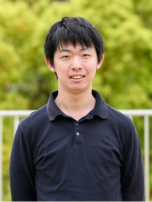

## Naotaka Shigeta (重田 直賢)

:::: {.profile-section}

::: {.profile-photo-area}

{width=150px .profile-photo}

:::

::: {.profile-text-area}

My research focuses on shock waves and compressible flows, using both experimental and computational approaches.

I am particularly interested in shock-wave interactions with various flow fields, including uniform flows, turbulence, and boundary layers, as well as with structures such as porous media and orifices.

[Google Scholar](https://scholar.google.co.jp/citations?user=K0Qp-fUAAAAJ&hl=ja){target="_blank"} |
[ORCID](https://orcid.org/0009-0006-9675-3147){target="_blank"} |
[researchmap](https://researchmap.jp/naotaka.shigeta){target="_blank"} |
[LinkedIn](https://www.linkedin.com/in/naotaka-shigeta-b9a237287/?locale=ja){target="_blank"} |

:::

::::

## Research Experience

**Apr. 2026–Present**  
JSPS Research Fellow (DC2), Japan Society for the Promotion of Science (JSPS)

**Aug. 2025–Jan. 2026**  
Visiting Student, Department of Engineering, University of Cambridge, UK

## Education

**Apr. 2025–Present**  
Ph.D. Student in Aerospace Engineering, Graduate School of Engineering, Nagoya University

**Apr. 2023–Mar. 2025**  
M.E. in Aerospace Engineering, Graduate School of Engineering, Nagoya University

**Apr. 2019–Mar. 2023**  
B.E. in Mechanical and Aerospace Engineering, School of Engineering, Nagoya University

## Latest Updates

- **Nov. 2026** — Presented at the 24th JSFM Chubu Meeting and received an award.
- **Oct. 2026** — A journal paper was accepted in *Physics of Fluids*.
- **Aug. 2026** — Personal website launched.
- **Jan. 2026** — Completed a research stay at the University of Cambridge.
- **Jul. 2025** — A journal paper was accepted in *Shock Waves*.