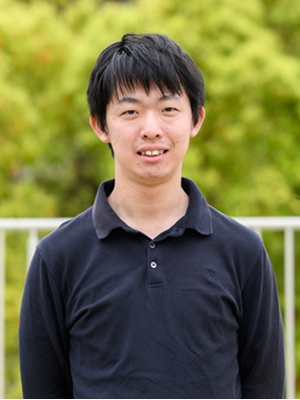

## 重田直賢 (しげた なおたか)

:::: {.profile-section}

::: {.profile-photo-area}

{width=150px .profile-photo}

:::

::: {.profile-text-area}

衝撃波・圧縮性流体を対象とし，実験と数値計算の両面から研究を行っています．

特に，前方誘起流れ，乱流，境界層などの様々な流れ場と衝撃波との干渉，さらには多孔質体やオリフィスなどと衝撃波との干渉現象に着目しています．

[Google Scholar](https://scholar.google.co.jp/citations?user=K0Qp-fUAAAAJ&hl=ja){target="_blank"} |
[ORCID](https://orcid.org/0009-0006-9675-3147){target="_blank"} |
[researchmap](https://researchmap.jp/naotaka.shigeta){target="_blank"} |
[LinkedIn](https://www.linkedin.com/in/naotaka-shigeta-b9a237287/?locale=ja){target="_blank"} 

:::

::::

## 経歴

**2026年4月–現在**  
日本学術振興会 特別研究員 (DC2) 

**2025年8月–2026年1月**  
Visiting Student, Department of Engineering, University of Cambridge, UK

## 学歴

**2025年4月–現在**  
名古屋大学 工学研究科 航空宇宙工学専攻 博士後期課程

**2023年4月–2025年3月**  
名古屋大学 工学研究科 航空宇宙工学専攻 博士前期課程

**2019年4月–2023年3月**  
名古屋大学 工学部 機械航空工学科 

## ニュース

- **2026年11月** — 日本流体力学会中部支部講演会で発表，受賞
- **2026年10月** — 論文が「Physics of Fluids」に掲載
- **2026年8月** — 個人ウェブサイトを公開
- **2026年1月** — ケンブリッジ大学での研究滞在を完了
- **2025年7月** — 論文が「Shock Waves」に掲載
